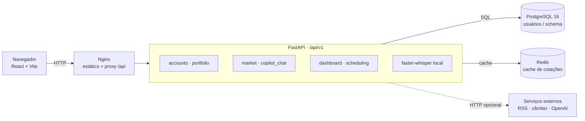
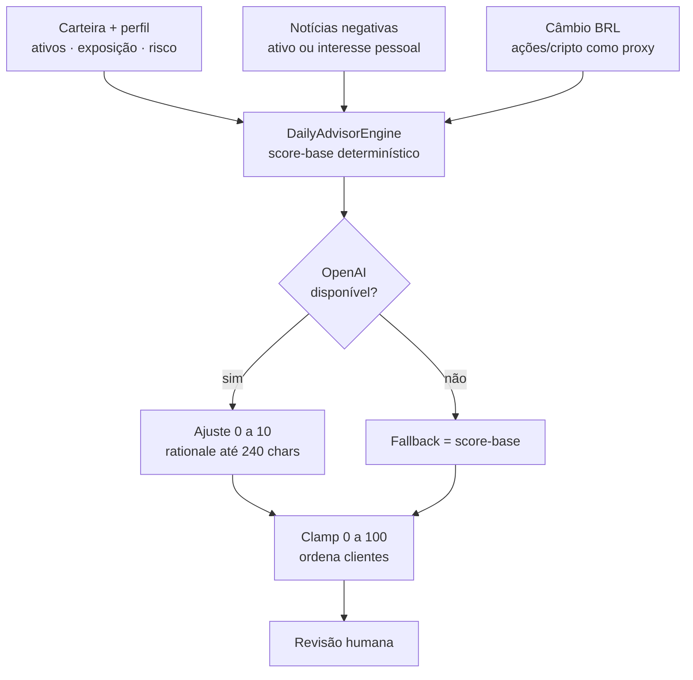
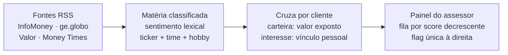
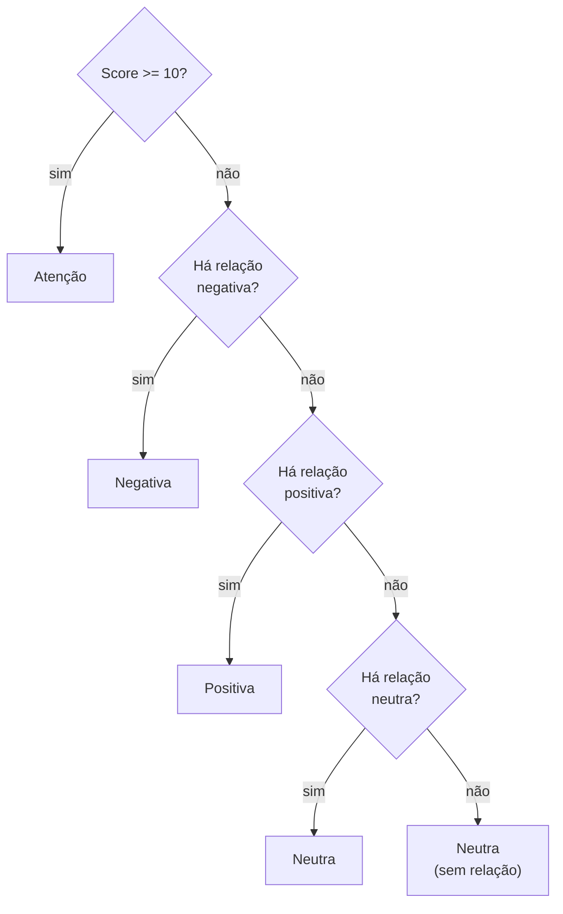
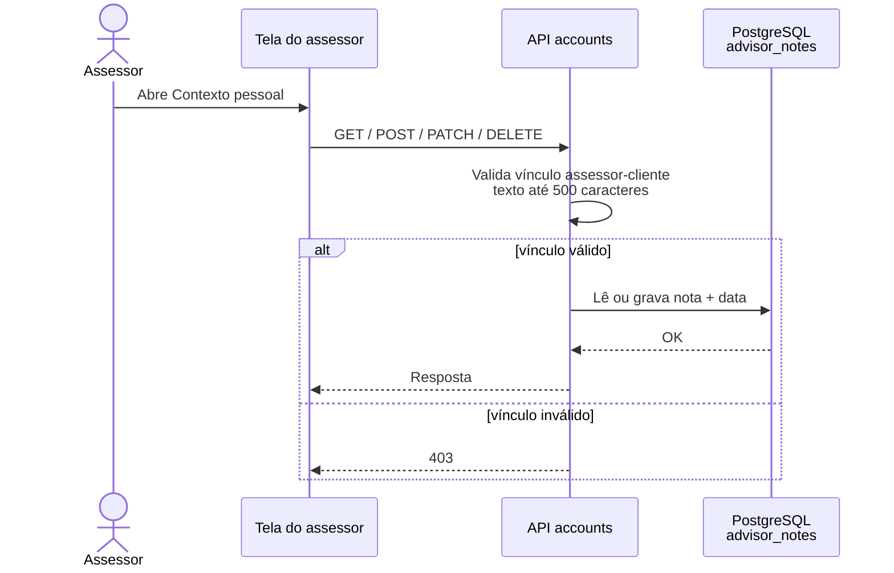
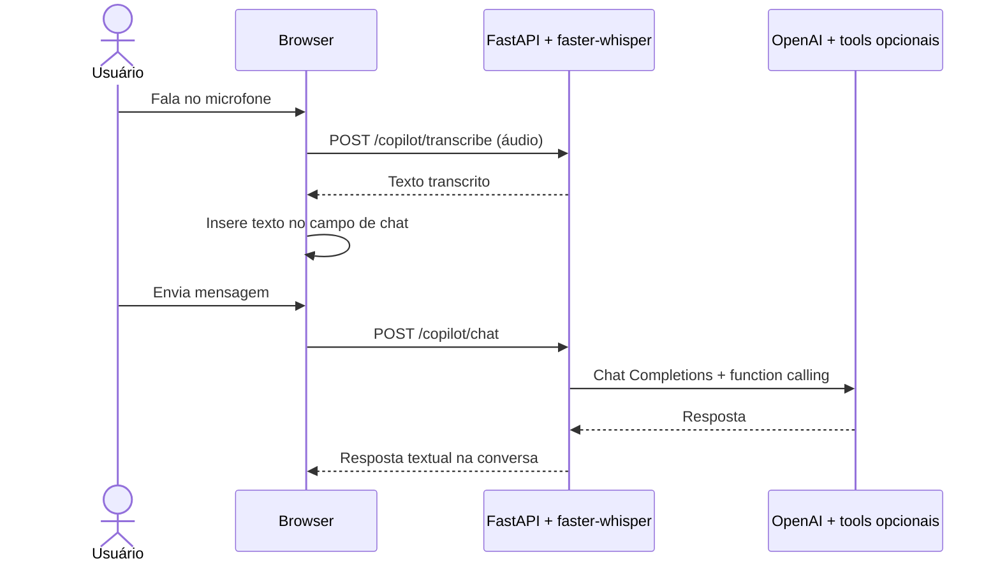
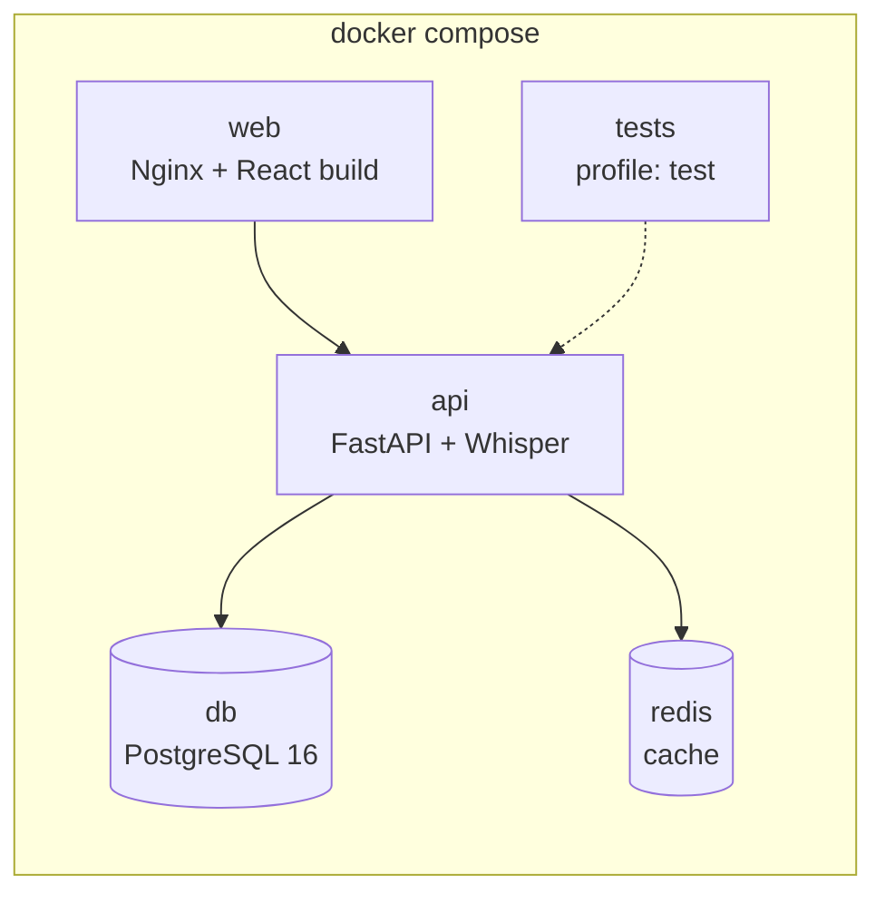

# Plataforma de assessoria financeira — Arquitetura e fluxos

> Hackathon XP · Grupo 7 · Documentação do runtime

Arquitetura e fluxos que existem no repositório atual: interface React, API FastAPI, serviços de dados, transcrição local e priorização assistida por regras e LLM.

**Stack:** Python / FastAPI · React / TypeScript · Docker Compose · faster-whisper · PostgreSQL 16 · Redis

---

## 01 · Visão do sistema

Um monólito modular expõe rotas REST em `/api/v1`. O Nginx serve o frontend e encaminha as chamadas de API. O modelo de voz roda localmente no container da API; o copiloto textual chama a OpenAI quando há credencial.



> O frontend e a API ficam limitados a `localhost` no Compose; **não há autenticação por usuário**. Integrações externas não são necessárias para subir o stack, mas a OpenAI requer chave para as respostas do copiloto.

---

## 02 · Módulos do monólito

| Módulo | Responsabilidade |
|---|---|
| `accounts` | Perfis, contexto pessoal e CRUD persistido de anotações privadas do assessor, validando o vínculo assessor-cliente. Parte da suitability ainda não está ligada ao router atual. |
| `portfolio` | Carteira unificada e pedidos. Integração real com Open Finance é stub; holdings de demonstração são semeados em memória. |
| `market_intelligence` | Leitura RSS com `defusedxml` e sentimento lexical, linha de câmbio externa e cotações com cache/fallback. |
| `copilot_chat` | OpenAI Chat Completions com function calling, histórico em memória e endpoint de transcrição de áudio local. |
| `advisor_dashboard` | Overview, exposição noticiosa, pontuação de criticidade e próxima melhor ação para revisão humana. |
| `scheduling` | Horários livres, conflitos e confirmação bilateral; reuniões permanecem em memória. |

---

## 03 · Fluxo de criticidade

A pontuação é calculada por regras determinísticas, com um ajuste opcional do LLM. Notícias negativas de carteira e de interesse pessoal afetam o score; notícias positivas e neutras informam a flag de relação, mas não aumentam a urgência. O LLM não define fatos, não pode reduzir o score-base e sua contribuição é validada e limitada.



**Tetos por componente:**

| Componente | Máximo |
|---|---|
| Notícia financeira | 40 |
| Notícia pessoal negativa | 20 |
| Câmbio | 15 |
| Ajuste LLM | 10 |
| **Total** | **100** |

```text
score diário = min(100, notícia financeira + notícia pessoal + câmbio + ajuste LLM)
```

O engine também aceita a forma: `queda × peso_risco + 10 × gatilhos + min(dias_sem_contato / 3, 30)`.

- **Notícia financeira negativa:** soma 1 ponto por ponto percentual de exposição afetada, ajustado pelo perfil (conservador 1,5; moderado 1,0; arrojado 0,6), limitado a 40.
- **Notícia pessoal negativa** (time favorito ou hobby): 10 pontos por matéria, limitado a 20.
- **Câmbio:** limitado a 15. **Ajuste OpenAI:** limitado a 10.
- O agregador não fornece queda diária, gatilhos de relacionamento ou inatividade; esses sinais permanecem zerados.

> A variação cambial usa a exposição em ações/cripto como proxy, não uma medida de exposição cambial real. O score prioriza revisão humana e **não é recomendação de investimento**.

### Notícia, cliente e flag exibida

A flag à direita de cada cliente é única: score a partir de 10 produz **Atenção**; abaixo de 10, a relação negativa prevalece sobre positiva e neutra. Sem relação financeira ou pessoal, a flag é neutra.





A caixa de notícias mostra quatro matérias por vez e permite rolagem; cada vínculo identifica cliente e motivo (carteira ou interesse).

---

## 04 · Anotações privadas do assessor

A aba **Contexto pessoal** existe apenas na tela do assessor. Listar, criar, editar e apagar são operações persistidas em `advisor_notes`. Cada rota verifica se o cliente pertence ao assessor informado; as notas não são expostas na tela do cliente.



```http
GET    /api/v1/accounts/advisors/{advisor_id}/clients/{client_id}/notes
POST   /api/v1/accounts/advisors/{advisor_id}/clients/{client_id}/notes
PATCH  /api/v1/accounts/advisors/{advisor_id}/notes/{note_id}
DELETE /api/v1/accounts/advisors/{advisor_id}/notes/{note_id}
```

> **Limite de privacidade:** a interface não mostra notas ao cliente e o backend verifica o vínculo entre IDs, mas **não autentica a identidade do assessor**. Isso não é autorização segura contra chamadas diretas à API. Em banco antigo, a tabela é criada sob demanda; hobbies, time favorito e datas familiares podem ser convertidos em notas iniciais.

---

## 05 · Voz e chat

O navegador grava áudio e envia o blob para o endpoint de transcrição. O `faster-whisper` converte o áudio em texto localmente no serviço. O frontend insere a transcrição no campo de mensagem; o chat textual usa OpenAI e ferramentas de domínio.



> Sem `OPENAI_API_KEY`, a transcrição funciona; as respostas que dependem do copiloto LLM não. O áudio é transcrito localmente, mas a conversa com o copiloto continua dependente da OpenAI.

---

## 06 · Persistência e integrações

| Componente | Uso atual | Persistência / dependência |
|---|---|---|
| **PostgreSQL** | Schema e seed de usuários, carteiras/posições, notícias e dados relacionais; notas privadas em `advisor_notes`. | Volume Docker persistente; em banco antigo, a tabela é criada e o contexto migrado na primeira chamada. |
| **Memória da API** | Holdings de demonstração (`src/seed.py`), reuniões, contexto/histórico do chat e pedidos. | Perde-se quando o processo da API reinicia. |
| **Redis** | Cache/pub-sub de cotações; sem cache há fallback de preço. | Serviço no Compose. |
| **RSS e câmbio** | Feed configurável, parsing XML protegido e análise lexical; câmbio consultado externamente. | Exigem rede; têm caminhos de fallback parciais. |
| **OpenAI** | Resposta do copiloto e ajuste assistivo do score. | Requer `OPENAI_API_KEY`; sem chave, o score determinístico permanece. |
| **Open Finance** | Abstração e modelos existem; conexão com instituições é stub. | Sem integração bancária real. |

> O repositório também mantém uma trilha SQLite legada em `db/schema.sql`, `db/seed.sql`, `db/init_db.py` e `db/app.db`. Ela **não** é usada pelo runtime FastAPI/PostgreSQL atual.

---

## 07 · Execução



```bash
# subir o stack
docker compose up --build -d

# rodar os testes
docker compose --profile test run --rm tests
```

---

## 08 · Limites e segurança

> ⚠️ **Uso pretendido do MVP:** não publicar nem usar com dados financeiros reais. O projeto não implementa autenticação. Algumas rotas validam vínculo entre IDs, inclusive as notas do assessor, mas IDs fornecidos pela chamada não comprovam a identidade de quem acessa nem substituem autorização por usuário.

- **Sem login:** a seleção de perfil na interface é uma conveniência de demonstração, não um mecanismo de autenticação.
- **Dados voláteis:** agenda, chat e holdings de demonstração são parcialmente mantidos em memória.
- **Integrações parciais:** Open Finance e cotações reais não estão conectados; RSS, câmbio e OpenAI dependem de serviços externos.

---

*Documentação do código atual · Hackathon XP · Grupo 7*
