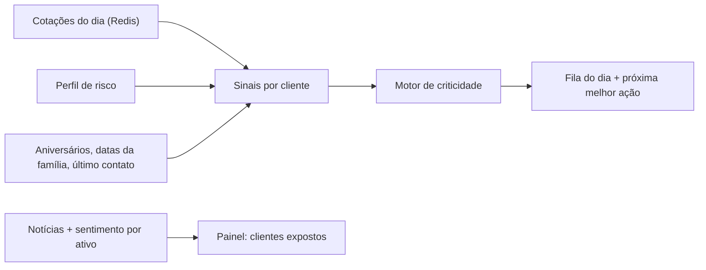

# XP.inc — Pitch do Hackathon XP · Grupo 7

> **O copiloto do assessor XP: quem ligar hoje, por quê e o que dizer.**

Este documento acompanha a apresentação de 5 minutos: o problema, a solução, as decisões do projeto, o roteiro da demo e a divisão das falas.

**Slides:** (https://canva.link/qjwbn8riqowsfsi)

---

## Sumário

1. [Objetivo](#objetivo)
2. [A dor do assessor](#a-dor-do-assessor)
3. [A solução](#a-solução)
4. [Motor de criticidade](#motor-de-criticidade)
5. [Demo](#demo)
6. [Decisões técnicas](#decisões-técnicas)
7. [Estado do MVP](#estado-do-mvp)
8. [Roteiro do pitch (5 min) e divisão das falas](#roteiro-do-pitch-5-min-e-divisão-das-falas)
9. [Perguntas prováveis da banca](#perguntas-prováveis-da-banca)
10. [Como rodar](#como-rodar)
11. [Equipe](#equipe)

---

## Objetivo

A assessora abre **uma tela** e já sabe **quem ligar hoje, por quê e o que dizer**.

Para isso, o XP.inc junta três coisas:

| | O quê | Como |
|---|---|---|
| 01 | **Cliente 360°** | Carteira consolidada, perfil de risco e contexto pessoal num lugar só |
| 02 | **Notícia com endereço** | Notícias de fontes confiáveis, cada uma ligada aos clientes que ela atinge |
| 03 | **Fila do dia** | Clientes ordenados por criticidade, com a próxima melhor ação |

## A dor do assessor

Um assessor da XP acompanha dezenas de clientes, e a informação de que ele precisa está espalhada:

- **Carteira pela metade.** Parte do patrimônio do cliente está em outros bancos, fora da vista do assessor.
- **Perfil e contexto na memória.** Perfil de risco, time, família e aniversários ficam numa planilha ou na cabeça.
- **Notícia sem endereço.** Vários sites de notícia, e nenhum diz quais clientes cada notícia atinge. O assessor cruza notícia com carteira de cabeça.
- **Pedidos soltos.** Aporte, resgate e reunião chegam por WhatsApp, e-mail e ligação, sem fila.

**Resultado: atendimento reativo.** A cliente conservadora lê a notícia antes de a assessora ligar.

## A solução

### 1. Cliente 360°

- Carteira da XP **junto com contas de outras instituições**, via Open Finance, com consentimento do cliente.
- **Perfil de risco** (Conservador, Moderado ou Arrojado) definido numa análise de perfil feita por voz: o cliente grava a resposta, ela é transcrita e os tópicos vão sendo marcados.
- **Contexto pessoal:** time, hobbies, datas da família e histórico de contatos com a assessora.

### 2. Radar de notícias

- Coleta de **fontes confiáveis**, como CNN Brasil e InfoMoney. Cada notícia guarda fonte e URL, sem duplicar.
- Cada notícia é ligada aos **ativos, setores ou temas macro que cita** (ex.: `ITUB4`, `BANCOS`, `SELIC`), com um sentimento de −1 a +1.
- O painel mostra **quais clientes estão expostos** a cada notícia.

### 3. Copiloto por voz (lado do cliente)

- O cliente fala ou escreve naturalmente: *"quero aportar 50 mil em cripto"*, *"quero marcar uma reunião"*.
- O Gemini transforma a frase em **ação** por function calling: registra um pedido de alteração de carteira ou pré-agenda uma reunião num horário livre real.
- A assessora é **avisada no painel**. Nada é executado sem ela: o pedido entra como pendente e a reunião só vale depois da confirmação.

## Motor de criticidade

Cada cliente recebe uma nota de **0 a 100** por dia (`src/modules/advisor_dashboard/engine.py`):

```text
score          = mínimo(100, mercado + relacionamento + inatividade + notícias + câmbio + LLM)
mercado        = queda da carteira no dia (%) × peso do perfil × 5
relacionamento = 10 × número de gatilhos de relacionamento
inatividade    = mínimo(dias sem contato ÷ 3, 30)
```

Na fila diária, notícias negativas também diferenciam clientes com o mesmo perfil: impacto financeiro soma a exposição percentual afetada (ajustada pelo perfil, limitado a 40 pontos) e notícia negativa de interesse pessoal acrescenta 10 pontos por matéria, limitado a 20. Notícias positivas e neutras não aumentam a criticidade. O agregador atual ainda não fornece os sinais de queda diária, gatilhos de relacionamento e inatividade ao motor.

**Peso do perfil:** quanto maior a aversão a risco, mais uma queda pesa.

| Perfil | Peso |
|---|---|
| Conservador | ×3 |
| Moderado | ×2 |
| Arrojado | ×1 |

**Gatilhos de relacionamento** (`src/modules/advisor_dashboard/orm.py`): aniversário hoje · data da família em até 7 dias · 30 dias ou mais sem contato.

**Faixas no painel** (`web/src/lib.ts`): 40 ou mais = **Crítico** · 10 a 39 = **Atenção** · abaixo de 10 = **Estável**. A fila do assessor exibe primeiro o maior score e alerta no cabeçalho quando há clientes que requerem revisão.

**Próxima melhor ação:** queda em carteira conservadora → *"Ligar para acalmar e revisar exposição"*; aniversário → *"Enviar felicitações"*; demais casos → *"Contato de acompanhamento"*.

**Exemplo:** a carteira cai 2% no dia. Helena (conservadora) soma 2 × 3 × 5 = **30 pontos**; Rafael (arrojado) soma 2 × 1 × 5 = **10 pontos**.



> A documentação de arquitetura (`documentacao-projeto.html`) mostra pesos antigos (1,8 / 1,2 / 0,8). Os valores que valem são os do código, descritos acima.

## Demo

**Personagens dos dados de demonstração** (`db/02_seed.sql`, os mesmos de `web/src/api/mock.ts`):

| Pessoa | Papel | Destaque na demo |
|---|---|---|
| Marina Azevedo | Assessora | Dona do painel |
| Helena Duarte | Cliente conservadora | Tem ações de banco; parte do patrimônio no Banco Aurora (Open Finance) |
| Rafael Monteiro | Cliente arrojado | Pediu por voz um aporte de R$ 50 mil em cripto |
| Beatriz Nogueira | Cliente moderada | Conta externa na Corretora Litoral |
| Otávio Lins | Cliente moderado | Aniversário hoje |
| Camila Prates | Cliente conservadora | CDB vence em 9 dias |

**Roteiro (60 s):**

1. **Painel da assessora.** Entrar como Marina: patrimônio sob assessoria por classe, clientes por perfil, fila do dia por criticidade, agenda, pedidos e notícias com os clientes expostos.
2. **Detalhe do cliente.** Abrir o primeiro da fila: carteira consolidada (XP + Open Finance), respostas da análise de perfil, contexto pessoal e notícias que afetam a carteira.
3. **Visão do cliente.** Trocar para um cliente: análise de perfil por voz e, no copiloto, *"quero marcar uma reunião"* → reunião pré-agendada num horário livre real.
4. **Volta à assessora.** A reunião aparece aguardando confirmação: quem não pediu é quem confirma.

**Preparo:**

- [ ] Rodar o front com dados simulados (`VITE_USE_MOCKS=true`, o padrão) para não depender de rede nem do backend.
- [ ] Lembrar que a transcrição de voz vai ao backend mesmo com dados simulados. Se a rede falhar, digitar a resposta em vez de gravar.
- [ ] Deixar o app aberto na tela "Quem está acessando?" antes do pitch. A entrada é por perfis prontos, sem senha.
- [ ] Plano B: gravação de tela da demo pronta para tocar.

## Decisões técnicas

| Decisão | Por quê |
|---|---|
| **Monólito modular em FastAPI**, seis módulos | Rápido de subir no hackathon; cada módulo tem contrato próprio (`models.py`) e pode virar serviço depois |
| **PostgreSQL 16 + Redis** | Histórico e integridade no Postgres; cotações em tempo real no Redis |
| **Gemini com function calling**; voz transcrita pela **AssemblyAI** | O copiloto executa ações (agendar, registrar pedido) em vez de só responder |
| **React + TypeScript** com uma interface de dados única (`web/src/api/types.ts`) | A mesma tela roda com dados simulados (`mock.ts`) ou com a API (`http.ts`): front e back andaram em paralelo |
| **Open Finance por consentimento** | Consentimento por instituição, com permissões e validade; tokens de acesso fora do banco em texto puro (LGPD) |
| **Dinheiro em `Decimal`**, nunca `float` | Nenhum valor em reais sujeito a arredondamento |
| **Entrada por perfis prontos** na demo | Um clique entra como assessora ou cliente, sem e-mail nem senha, para a demo não perder tempo |

**Módulos do backend** (`src/modules/`):

| Módulo | Responsabilidade |
|---|---|
| `accounts` | Usuários, perfil de risco, contexto pessoal e histórico de contatos |
| `portfolio` | Carteira, posições, pedidos de alteração e integração Open Finance |
| `market_intelligence` | Cotações (Redis) e notícias com sentimento por ativo |
| `copilot_chat` | Chat e voz com Gemini e as ações que ele pode disparar (`tools.py`) |
| `advisor_dashboard` | Motor de criticidade, próxima melhor ação e visão geral do assessor |
| `scheduling` | Disponibilidade da assessora e reuniões |

## Estado do MVP

**Pronto:**

- [x] Telas do assessor e do cliente navegáveis, com dados simulados
- [x] Agenda na API: horários livres, conflito de horário (409) e confirmação dos dois lados
- [x] Análise de perfil por voz, com transcrição
- [x] Banco PostgreSQL modelado (`db/01_schema.sql`), com dados de demonstração e testes
- [x] Visão geral da carteira do assessor servida pela API (`GET /advisor/{id}/overview`)

**Próximos passos:**

- [ ] Gemini respondendo de verdade no copiloto (hoje é um stub)
- [ ] Coleta automática de notícias e cálculo de sentimento (hoje as manchetes da demo são fictícias)
- [ ] Open Finance real e cotações do dia alimentando o motor de criticidade
- [ ] Login com JWT e alertas em tempo real (WebSocket)

Troquem de apresentador só entre blocos. Se o ensaio estourar, cortem primeiro nas decisões técnicas, nunca na dor nem na demo.

.

## Como rodar

```bash
# Front com dados simulados (ideal para a demo) — http://localhost:5173
cd web && npm install && npm run dev

# Backend local (venv em .venv) — documentação da API em /docs
pip install -r requirements.txt
uvicorn src.main:app --reload --port 8000

# Ou tudo junto: API + PostgreSQL 16 + Redis
docker compose up --build
```

`VITE_USE_MOCKS` no front: `true` (padrão, tudo simulado), `partial` (só a agenda vai ao FastAPI) ou `false` (tudo no FastAPI; algumas telas ainda não têm rota).


<sub>Hackathon XP · Grupo 7 · Jornada do Assessor</sub>
