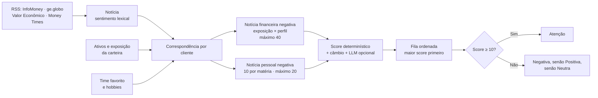
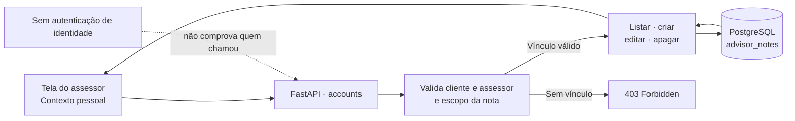

# Plataforma XP G7

MVP web para assessores financeiros e clientes. A interface React consome uma API FastAPI organizada por módulos; o ambiente Docker reúne frontend, API, PostgreSQL e Redis.

## Executar com Docker

Requer Docker Engine e Docker Compose. Na primeira execução, o build baixa dependências, compila a interface e inclui o modelo `faster-whisper tiny` na imagem da API.

```bash
docker compose up --build -d
```

- Interface: http://localhost:8080
- API e OpenAPI: http://localhost:8000/docs
- PostgreSQL: `localhost:5432`
- Redis: `localhost:6379`

As portas publicadas são limitadas a `localhost` e podem ser alteradas em `.env`; consulte [.env.example](.env.example). O banco recebe `db/01_schema.sql` e `db/02_seed.sql` na primeira inicialização do volume. Não apague o volume para aplicar alterações de schema em uma instalação existente; use os scripts de banco conscientemente.

Para habilitar as respostas do copiloto, configure `OPENAI_API_KEY` no `.env`. Sem essa chave, o restante do stack sobe, incluindo a transcrição local; chamadas de chat que dependem do LLM não conseguem responder.

```bash
docker compose logs -f
docker compose down                         # mantém os dados do PostgreSQL
docker compose --profile test run --rm tests # executa a suíte no container
```

## Desenvolvimento local

Backend, com PostgreSQL e Redis já disponíveis:

```bash
python -m venv .venv
source .venv/bin/activate
pip install -r requirements.txt
uvicorn src.main:app --reload --port 8000
```

Frontend:

```bash
cd web
npm ci
npm run dev
```

O frontend usa a API real por padrão. Para substituir os dados da interface pelos mocks, defina `VITE_USE_MOCKS=true` em `web/.env`. O endpoint de desenvolvimento do Vite encaminha `/api` para o FastAPI.

### PostgreSQL local sem Docker no Linux x86_64

O script abaixo usa Node 22 e PostgreSQL empacotado no diretório do usuário; não instala pacotes de sistema:

```bash
npm install --prefix ~/.local/embedded-postgres embedded-postgres@17.10.0-beta.17
node scripts/local-postgres.mjs start
```

Mantenha o processo ativo enquanto roda a API/testes. Para parar: `node scripts/local-postgres.mjs stop`. Os dados persistem em `~/.local/share/hackathon-xp-postgres`.

## Checagens

Com o ambiente virtual configurado e PostgreSQL disponível:

```bash
.venv/bin/python -m pytest tests
.venv/bin/mypy src tests
.venv/bin/ruff check src tests
.venv/bin/ruff format --check src tests
.venv/bin/flake8 src tests
```

O Flake8 usa [.flake8](.flake8): largura 88, igual ao Ruff. E501 é ignorado porque há textos de prompt, mensagens e conteúdo de demonstração que não devem ser partidos automaticamente; Ruff continua verificando e formatando o código. A dependência de Flake8, Ruff e mypy está em `requirements.txt`.

## Arquitetura

- `src/main.py` registra os routers sob `/api/v1`; `src/core/` contém configuração, SQLAlchemy, Redis e tratamento de erros.
- `accounts`: usuários/perfis, contexto pessoal e anotações privadas do assessor. As notas têm CRUD persistido em PostgreSQL e cada operação confere se o cliente está vinculado ao assessor informado. Parte da análise de suitability continua em memória; o módulo `suitability.py` não está conectado às rotas atuais.
- `portfolio`: carteiras consolidadas pela abstração local de Open Finance. A integração bancária real ainda é stub; holdings de demonstração são carregadas em memória por `src/seed.py`.
- `market_intelligence`: RSS, classificação lexical de sentimento, cotação de fallback e linha de câmbio externa.
- `copilot_chat`: OpenAI Chat Completions e function calling; o LLM é opcional na inicialização, mas necessário para respostas do copiloto.
- `advisor_dashboard`: prioridade por perfil, notícia associada à exposição, variação BRL e ajuste limitado do LLM; score total limitado a 100. O engine também aceita queda de carteira, gatilhos e inatividade, mas o agregador diário atual não popula esses três sinais, que permanecem zerados.
- `scheduling`: disponibilidade e reuniões em memória, com conflito e confirmação entre as partes.
- `web/`: React 18, TypeScript e Vite; cliente HTTP e mocks estão em `web/src/api/`.

### Criticidade

O cálculo determinístico agrega notícias, exposição cambial estimada e, quando configurado, até 10 pontos de ajuste do LLM. Notícias financeiras negativas ligadas a ativos somam 1 ponto por ponto percentual de exposição, ajustado pelo perfil de risco e limitado a 40. Notícias negativas ligadas a time favorito ou hobby somam 10 pontos por matéria, limitados a 20. Sentimentos positivos e neutros não aumentam urgência. A variação de BRL usa a proporção em ações e cripto como proxy de sensibilidade, não como exposição cambial medida. O score total é limitado a 100 e ordena a fila do assessor. O engine aceita ainda sinais de queda diária, gatilhos de relacionamento e inatividade, mas o agregador atual não os fornece. Isso é priorização para revisão humana, não recomendação de investimento.

Na lista de clientes, cada pessoa mostra uma única flag à direita: **Atenção** para score a partir de 10; abaixo desse valor, prevalece o sentimento de notícia relacionada nesta ordem: **Negativa**, **Positiva**, **Neutra**. O vínculo pode ser por exposição na carteira ou por interesse pessoal e não mistura relacionamento com exposição financeira.



Na caixa de notícias do assessor, quatro matérias ficam visíveis por vez. Cada matéria mostra sentimento, fonte, horário, manchete e clientes vinculados, com o motivo da relação; a lista pode ser rolada para ver as demais.

### Anotações do assessor

A aba **Contexto pessoal** fica disponível na tela do assessor e permite listar, criar, editar e apagar notas de até 500 caracteres. O banco guarda as notas em `advisor_notes`; quando a tabela é criada pela primeira vez, hobbies, time favorito e datas familiares existentes são convertidos em notas iniciais. A API valida o vínculo entre cliente e assessor em cada operação.



Rotas de anotação:

- `GET /api/v1/accounts/advisors/{advisor_id}/clients/{client_id}/notes`
- `POST /api/v1/accounts/advisors/{advisor_id}/clients/{client_id}/notes`
- `PATCH /api/v1/accounts/advisors/{advisor_id}/notes/{note_id}`
- `DELETE /api/v1/accounts/advisors/{advisor_id}/notes/{note_id}`

**Privacidade:** a interface mostra o recurso somente na tela do assessor e o backend verifica o vínculo com o cliente, mas o MVP não autentica a identidade de quem envia `advisor_id`. Portanto, isso não equivale a controle de acesso seguro; não publique a aplicação nem use dados financeiros reais.

Endpoints do assessor:

- `GET /api/v1/advisor/{advisor_id}/priorities`
- `GET /api/v1/advisor/{advisor_id}/news-impact`
- `GET /api/v1/advisor/{advisor_id}/overview`

### Voz e chat

`POST /api/v1/copilot/transcribe` recebe áudio binário e usa `faster-whisper` localmente. O modelo `tiny` está pré-carregado na imagem Docker; em execução fora dela, o modelo é obtido na primeira utilização. É usado no onboarding e no chat para converter áudio em texto. O chat posterior usa OpenAI e, portanto, exige `OPENAI_API_KEY`.

### Dados e limites atuais

PostgreSQL persiste usuários, anotações do assessor e os dados relacionais definidos em `db/01_schema.sql`; carteiras de demonstração, agenda e histórico/contexto do chat têm partes em memória e podem ser reinicializados ao reiniciar a API. Em bancos antigos, a tabela `advisor_notes` é criada sob demanda pelo serviço de anotações e o contexto pessoal existente é migrado para notas na primeira inicialização. RSS/câmbio dependem de serviços externos; cotações podem usar fallback local. `db/schema.sql`, `db/seed.sql`, `db/init_db.py` e `db/app.db` são uma trilha SQLite legada, separada do runtime FastAPI/PostgreSQL, e foram mantidos por serem versionados/documentados.

**Segurança:** este MVP não implementa autenticação. Algumas operações, inclusive anotações, validam a relação entre os IDs informados, mas isso não comprova a identidade de quem chama a API nem substitui autorização por usuário. Mantenha a instalação local, use dados fictícios e não publique os serviços nem use dados financeiros reais.

## Documentação

- [Arquitetura, componentes e diagramas atualizados](documentacao-projeto.html)
- [Apresentação do projeto](PITCH.md)
- [Decisões visuais](web/DESIGN.md)
- [Documentação da trilha SQLite legada](db/README.md)
- [Licença](LICENSE)
